<!-- Cards are generated by scripts/render_cards.py and refreshed daily by .github/workflows/cards.yml -->

<picture>
  <source media="(prefers-color-scheme: dark)" srcset="cards/dark/hero.svg">
  
</picture>

<a href="https://github.com/CoderHaste?tab=repositories&language=python"><picture><source media="(prefers-color-scheme: dark)" srcset="cards/dark/tile-ml.svg"></picture></a>
<a href="https://github.com/CoderHaste?tab=repositories&language=c%2B%2B"><picture><source media="(prefers-color-scheme: dark)" srcset="cards/dark/tile-hardware.svg"></picture></a>
<a href="https://github.com/CoderHaste?tab=repositories"><picture><source media="(prefers-color-scheme: dark)" srcset="cards/dark/tile-all.svg"></picture></a>

<picture>
  <source media="(prefers-color-scheme: dark)" srcset="cards/dark/activity.svg">
  
</picture>

<a href="https://github.com/CoderHaste/ather-obd-monitor"><picture>
  <source media="(prefers-color-scheme: dark)" srcset="cards/dark/repo-ather-obd-monitor.svg">
  
</picture></a>

<a href="https://github.com/CoderHaste/Customer-Churn-Prediction-ML"><picture>
  <source media="(prefers-color-scheme: dark)" srcset="cards/dark/repo-Customer-Churn-Prediction-ML.svg">
  
</picture></a>

<a href="https://github.com/CoderHaste/Hyperparameter-Optimization-Optuna-vs-GridSearch"><picture>
  <source media="(prefers-color-scheme: dark)" srcset="cards/dark/repo-Hyperparameter-Optimization-Optuna-vs-GridSearch.svg">
  
</picture></a>

<picture>
  <source media="(prefers-color-scheme: dark)" srcset="cards/dark/graph.svg">
  
</picture>
